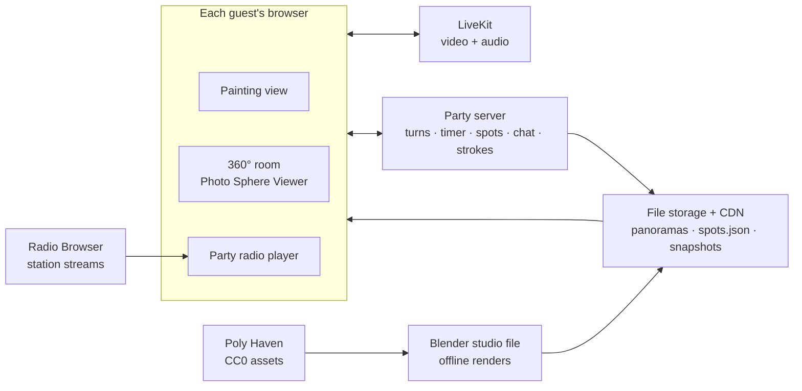

# Architecture

Video goes through LiveKit, game state goes through one small party server, and the room comes from static images on a CDN.



## Responsibilities

| Piece | Owns | Never does |
| --- | --- | --- |
| Web app (`apps/web`) | Drawing input, rendering strokes, the room viewer, UI | Decide whose turn it is |
| Party server (`apps/server`) | Party rooms, members, turn order, the timer, spots, chat, stroke relay, round snapshots, LiveKit tokens | Touch video/audio |
| LiveKit | Video and audio between guests | Store media (recording is off) |
| CDN | Panoramas, `spots.json`, table renders, final art | — |
| Radio | Each browser plays the stream URL directly | Relay audio through our servers |

## Message flow (party server, WebSocket)

All message types live in `packages/shared/src/protocol.ts`. Each message is JSON with a `type` field.

1. Client connects to `ws://…/party/:partyId` and sends `join { name, presence: 'camera' | 'avatar' }`.
2. Server replies with `welcome { you, state }`, the full party state including the latest canvas snapshot URL.
3. During a turn:
   - The painter sends `stroke` messages (batched points: x, y, pressure, plus tool, color, size and flow).
   - The server checks the sender is the current painter, then broadcasts the stroke to everyone else.
4. The server ticks the timer and broadcasts `timer { secondsLeft }` once a second.
5. At zero (or on `passNow` from the painter or host), the server asks the painter's client for a `snapshot` (PNG), stores it, advances the turn, and broadcasts `turn { painterId, round }`.
6. After the last round: `reveal { finalImageUrl, credits }`.

**Why strokes, not pixels?** A stroke is a few hundred bytes, and pixels would be megabytes. Strokes also make the replay time-lapse almost free.

**Why does the painter's client make the snapshot?** It already has the exact pixels. The server stays simple, with no canvas rendering on the server in phase 1. If cheating or drift becomes a problem, add server-side rendering later.

## Canvas coordinates

The canvas is 1600×1200 (4:3) in **canvas units**, whatever the screen size. Pointer positions are converted to canvas units before sending, so every screen draws the same thing.

## Spots and overlays

`spots.json` (exported from Blender) maps each named spot to a direction:

```json
{ "room": "loft", "spots": [ { "id": "spot_couch_left", "zone": "couch", "yaw": -40.0, "pitch": -12.5 } ] }
```

The room viewer turns each spot into a marker. The app code never hard-codes coordinates.

## Environments

| Env | Web | Party server | LiveKit |
| --- | --- | --- | --- |
| Local | Vite dev server :5173 | `tsx watch` :8787 | LiveKit Cloud dev project, or `livekit-server --dev` |
| Production | Static host + CDN at `passthecanvas.party` | Small Node host at `party.passthecanvas.party` | LiveKit Cloud (later: self-hosted) |
