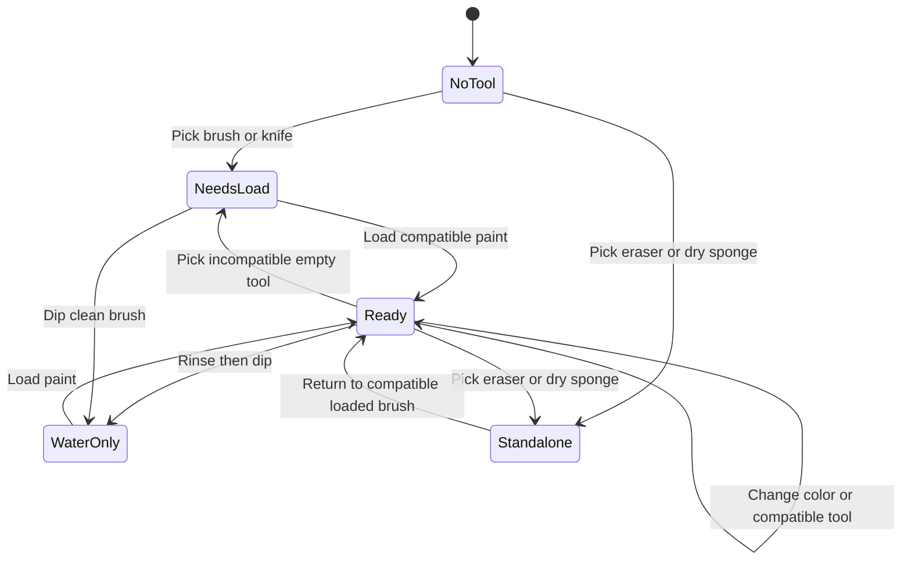

# Painting workspace — first design round

2026-10-29. Owner brief and five `_design/mockups` artboards reviewed against the current source. This is an implementation brief, not a shipped redesign. The owner's new mockups supersede the earlier jar/sidebar concept for the painting workspace. Button treatments, dimensions, physical paint behavior, and synchronization details remain proposals to test.

Companion notes: [interaction research](PAINTING-INTERACTION-RESEARCH.md), [asset measurements and extraction](PAINTING-ASSETS.md).

## What the mockups establish

| Artboard | Behavior to retain | Detail to resolve in a working study |
| --- | --- | --- |
| 01 Default | Objects frame a dominant canvas; no tool or color selected | One visible invitation to choose a tool; all objects also have text names |
| 02 Tool selected | Shape-following active outline, nearby size/preview controls, compatible supplies remain available | Preview represents the actual brush tip; without paint, label it “Brush shape” rather than implying yellow paint is loaded |
| 03 Color and medium selected | Both the brush and supply source remain visibly selected; top strip reports tool, color and acrylic | Distinguish selected tool, selected tray, and selected well; avoid three equally loud outlines |
| 04 Custom panel | Independent wood surface with chosen supplies; named panel and settings/menu actions | The panel's contents/layout are independent; painting selection is shared |
| 05 Selection in custom panel | Selecting a brush in a panel updates its controls and mutes incompatible items | Every other visible copy reflects the selection without opening a settings panel everywhere |

Keep the canvas edge, bevel, weave and contact shadow as separate decorative layers. Paint lives in a flat drawing surface inside that frame; decorative effects must not change pointer coordinates or get burned into downloaded art. The desktop artboard is 1440×1024; its PNG is 2×. The popup is 539×763 at 1×, not a phone layout already proven to work.

The settings button is the provisional primary style; the three-dot action is provisional secondary. Test both on Undo, Save, panel settings, menus, disabled actions, hover, focus and touch before turning them into tokens. The yellow outline is a design reference, not yet a fixed color/width specification. Keep a separate visible keyboard focus indicator.

## The working model: tool → load → mark

Separate the **physical tool**, the **medium**, and what is currently **loaded**. A flat brush is not a medium; watercolor is not a brush shape. Keep layout placement out of this state entirely.

- Initial state: no tool and no load; the canvas does not silently paint black. Selecting a brush exposes settings and compatible supplies.
- Selecting a compatible paint loads its named color and medium. Choosing another color of that medium replaces the load; changing the medium is explicit.
- Preserve a compatible load when switching brushes. If the new tool cannot use it, preserve it as remembered paint but mark the current tool unloaded. Do not silently turn watercolor into acrylic.
- Selecting a direct-mark material (pencil, charcoal, pastel) chooses its implement and color together. These supplies are not empty brushes waiting to be loaded.
- Eraser and dry texture sponge are immediately ready and use no added color. Keep the remembered paint available for returning to a brush; the status strip reports “No paint needed” for the active tool.
- Water is a loading/modifying action for compatible brushes and foam brushes. “Dip in water” wets the current load or selects a water-only action; “Rinse brush” clears pigment. Do not make those actions indistinguishable.
- Opening a settings panel never changes the selection. Hiding a selected widget never silently deselects its tool. A visible status-strip action can always reveal the selected tool.
- Switching state during an active stroke takes effect on the next stroke. One stroke freezes its settings at pointer-down; a second window must not alter half a stroke.

### Compatibility proposal

This is a deliberate product rule set to experiment with, not a claim that every real-world technique is covered.

| Physical tool/material | Acrylic | Watercolor | Water | No added medium |
| --- | --- | --- | --- | --- |
| Round, flat, detail, fan brush | Load paint | Load paint | Wet load / water-only | Unloaded; cannot add a mark |
| Foam/sponge brush | Load paint | Load paint | Wet load / water-only | Unloaded; cannot add a mark |
| Palette knife | Load paint | Unavailable | Unavailable | Scraping mode is a later experiment |
| Airbrush | Prepared color, digital approximation | No simulated brush-loaded watercolor | No dipping | Not ready without color |
| Charcoal / pastel / pencil | Not a paint applicator | Not a paint applicator | Water modifies marks through a wet brush | Direct material and its own color |
| Dry texture sponge | No paint loading | No paint loading | No dipping in this version | Texture / blend existing marks only |
| Eraser | No paint loading | No paint loading | No dipping | Lift existing marks only |

Mute only unavailable choices; don't fade every unselected object beyond recognizability. Keep unavailable options discoverable with an explanation such as “Palette knives use acrylic.” A focusable `aria-disabled` button can expose the reason, provided its handler blocks activation. Text labels and selected markers accompany color/outline states. A disabled tray must not contain accidentally active wells.

Watercolor should disperse/dilute; acrylic should thin and change handling; charcoal/pastel should smear or lift. “Lower viscosity” describes thinner flowing acrylic, while “drips” describes an additional movement effect. Full wetness, gravity, drying, and pigment physics are separate rendering work, not a slider label.

## Mixing: three different things to control

1. **Recipe:** any number of named colors with editable amounts. Show useful proportions (e.g. 3 blue : 1 red : 1 white), not just two slots or RGB sliders. Adding/removing a color preserves the others' amounts. Normalize positive amounts for calculations; a zero-total recipe cannot be loaded. Recalculate from ingredients, never repeatedly darken the previous result.
2. **How mixed:** uniform paint versus partially mixed paint. A mixing area can retain pools and streaks; dragging through it previews what the brush picks up. Every gesture also has controls for ingredients, amounts and pickup position.
3. **Brush load:** how paint sits across the tip and how much remains along the stroke. A blue/red split across a tip is different from blue becoming red over distance, and both differ from paint running out to expose the canvas.

Start with an adjustable multi-color recipe and a reusable test strip. Then compare two explicit loading modes: **Even mix** and **Streaked load**. A streaked load stores an ordered set of color bands/weights across the tip; a “Blend” control varies their separation. A later spatial mixing well can generate that load by sampling across a pickup path. Don't force the first prototype to simulate fluid paint in the palette.

Treat paint amount as optional expression. Default to automatic reload/unlimited paint while trying the tools. “Limited paint” exposes amount remaining and “Reload”; empty paint never removes the artist's tool or triggers a timer. Depletion depends on stroke distance/coverage and pressure, not how many browser pointer events happen to arrive. Include a preview for an even mix, streaked load, fading load, water-only stroke and erased/lifted mark. True pigment mixing requires a verified algorithm and licensing decision; the current darkened RGB average is not that algorithm.

## Trays are saved color collections

A collection has a stable identity, name, ordered wells, contents, medium information, and a saved revision. Its photographed tray shape is a presentation choice. A six-well appearance must not truncate a larger collection; offer another tray, pagination or overflow with a named list.

- A well may store a plain color, a named multi-pigment recipe, or a streaked load. Preserve ingredients/settings so it can be edited later, not only the final hex.
- **Save changes** updates the collection; **Save a copy** makes a new identity. **Revert changes** restores the last saved revision, with an undoable recovery copy when changes would be lost.
- Editing a collection updates all instances. Duplicating it creates an independent collection. Hiding or removing a tray widget does not delete its collection.
- **Recent colors** is a separate automatic tray: record colors/loads actually used to mark the canvas, not every preview or hover. Deduplicate by medium plus recipe/load identity and promote the most recently used. A starting capacity of 24 is a test value. Pin/copy to a named collection before history rolls off; never mutate an old recent entry when its source recipe changes.
- Export a versioned JSON collection with names, medium, recipe and load parameters; a simple hex list is an optional lossy export. Import previews count, colors and unsupported features; choose new copy or explicit replacement. Validate size, schema, numeric limits, and unique IDs. Treat names as text, never HTML, and do not fetch image/URL payloads from imported palettes.
- Palette sharing exports only collection data, never party IDs, account identifiers, canvas images or session credentials.

## One artist, many surfaces

Use three distinct concepts in implementation:

| State | Shared where | Example |
| --- | --- | --- |
| Artist painting state | All paired control surfaces for that artist | Selected brush, active load, size, water, collection edits |
| Display layout | Only that display/window | Which widgets are visible, position, size, stacking, snap and sorting |
| Workspace preset | Named saved collection of display/panel layouts | “Tracy's painting panel”, “Detail and finishing” |

A widget instance references a tool or collection; it doesn't own a separate brush engine. Multiple instances may be visible. Any can select a tool; all reflect that selection. Only the instance used to select it opens its local controls automatically.

Each display gets an **Arrange tools** mode so trying to paint never starts dragging the workbench. Offer drag handles plus Move controls (arrows or numeric position), size presets plus labeled size input, Reset position and Recover offscreen tools. Use a stable logical tab order independent of overlap. Establish per-tool min/max sizes by testing legibility and 44px targets; a tiny paint bottle cannot contain 24 tiny clickable colors. Selecting a crowded tray can open a larger labeled well chooser.

Category visibility is additive: selecting Brushes and Wet media shows their union. Separate global tool availability from display visibility. A display's Show/Hide actions affect only its layout, with clear All / Some / None group states. Clean up by name/category arranges visible unlocked widgets; Snap to grid affects future moves; pinned objects stay put. Clean up, hide-all, resize and preset switches are undoable layout changes, independent of canvas Undo.

Save panel names and layouts, support duplicates and dirty-state indication, and recover missing displays into a visible panel. Opening a preset with several windows requires browser-supported user actions; list panels to open individually if blocked. Closing the main tab must produce a clear disconnected state in companions, not a second independent artist.

Stage same-browser popouts before phone/tablet pairing. A moved browser window can work on another monitor; browsers cannot guarantee automatic window placement everywhere. An iPhone/iPad needs a paired browser session and server-mediated synchronization. Companion sessions must represent the same participant rather than join as a second guest or claim an extra turn/camera seat. Pairing, expiration, revocation, command ordering, stale-state recovery and authentication need an explicit design before changing the protocol. Do not use a shareable party link as control authority.

## Timer, saves, snapshots and undo

**Timer direction from the owner:** zero is a gentle cue to finish and pass. Keep the current painter authorized until an explicit handoff; no forced canvas lock, alarm or automatic reveal at zero. Freeze the display at zero and offer “Pass canvas”; an optional quiet chime is off by default. The server remains the authority. A host can still deliberately pass a stalled/disconnected turn; that action is explicit.

Finish an active stroke before an ordinary pass, then flush accepted operations, capture the agreed revision, and hand off. A host override or disconnect needs an ordered server cutoff so two people cannot paint at once. This requires a handoff design and tests, not simply removing the timer from the page.

Keep the top strip compact: tool/load status, Undo, save status, Snapshot, timer/Pass, and workspace menu. Detailed controls stay with the object or in a panel. Do not make the main row a dashboard.

| Action/status | Meaning |
| --- | --- |
| Autosaved / Save now | Acknowledged recoverable document revision, with saving, saved, offline and failed states; “saved” cannot mean only an in-memory stroke relay |
| Undo | Current artist's uncommitted/latest permitted stroke operations under an explicit shared-history rule; never silently undo a friend's finished turn |
| Snapshot | A deliberate artwork image + revision reference in a private personal album; distinct from server round checkpoints |
| Download | A local image export; independent of cloud account availability |
| Revert palette / Undo layout | Collection/layout history; never consumes canvas history |

Personal online albums are now a requested feature, but require a new persistence/privacy decision: current rules only allow party snapshots. Specify identity, private-by-default access, retention, delete/export, and what “edit” means (metadata/copy versus reopening editable artwork). Guests should still be able to download; don't silently upload party art into a public profile. Canvas/video/audio privacy remains unchanged. Automatic round snapshots on disk are not a personal album or autosave system.

## Responsive and accessible behavior

At 1440px, preserve the central canvas and object perimeter. At 360px, show the canvas with a compact status strip and selected-tool controls; open supplies in a tray/sheet rather than shrink the entire desktop. Same widgets and state, different default arrangement. Reflow at 320px/200% zoom; recover stored layouts when their viewport disappears.

Tool selection, color loading, recipes, resizing, arranging, switching panels, saving and passing all work by touch and keyboard. Native labeled sliders get numeric alternatives. Menus restore focus to their opener; popouts have titles and a route back; tooltips are not the only accessible names. No hover-only settings. Avoid live announcements for every drag/slider tick; announce committed changes and turn/pass/save events. Keyboard painting and movement alternatives are required accessibility, even though mnemonic tool shortcuts are deferred to v2. Reduced motion removes lift/slide effects; selected outlines and labels stay.

## Current source gaps

- `Studio.svelte`: local two-slot mix and a default loaded brush; no explicit tool/load readiness or widget layouts.
- `canvas/paints.ts`: weighted RGB average with artificial 2% darkening; not subtractive pigment behavior and not invariant when mixing a paint with itself.
- `canvas/brushes.ts`: one `tool` mixes implement and medium; `sponge` adds color, unlike the requested dry texture sponge. `water` smears/dilutes the flattened image identically regardless of medium.
- `canvas/PaintCanvas.svelte`: drawing uses live mutable settings rather than frozen settings per stroke; no keyboard painting path, canvas undo, or durable autosave.
- `packages/shared/src/protocol.ts`: no separate implement/medium/load representation, wetness/material map, shared undo operations, paired controller identity, layouts or palettes.
- `apps/server/src/party.ts`: zero calls `endTurn()` and stops accepting paint; round snapshots save PNGs to local disk. No durable stroke journal/account album.
- A PNG checkpoint loses medium/wetness/load history. Future material-aware replay/reconnection needs an accompanying state checkpoint or reconstruction from operations; pixels alone cannot recover those properties.

## Delivery order and review gates

This brief is owner-directed planning alongside phase 1. It does not declare phase 1 complete or authorize a protocol/dependency/service change.

| Slice | Files/seam | Acceptance before proceeding |
| --- | --- | --- |
| A. Asset and visual study | `_design/mockups/asset-review`, then approved web asset manifest, `studio/ASSET-CREDITS.md` | Complete object contours, matching photo/silhouette transforms, tested primary/secondary/focus states; owner confirms selection/look; asset provenance recorded before production promotion |
| B. Tool/load model study | Separate pure selection rules near `canvas/`, then `Studio.svelte` controls | Three mockup states; compatibility transitions; eraser/dry sponge without paint; brush/medium swaps; keyboard/touch at 360 and 1440; no multiplayer claims |
| C. Mixing and collections | `paints.ts`, recipe/load model and tray UI | Three-plus inputs; ratios reversible and order-independent; zeros handled; same-paint stability; tray duplicate/revert/recent/import/export; previews distinguish color mixing from depletion |
| D. Renderer and replay design | `brushes.ts`, `PaintCanvas.svelte`, shared stroke/checkpoint format | Agree implement/medium/load representation and migration before protocol edits; same ordered operations reproduce local/remote/late-join output; wetness/material recovery defined; stroke settings frozen |
| E. Gentle handoff + history | Server turns/snapshots and shared protocol; canvas Undo | Zero continues accepting authorized strokes; explicit pass preserves last stroke; late/stale strokes rejected; one painter at a time; meaningful save acknowledgement and undo rules |
| F. Workspaces and local popouts | Svelte artist state plus independent layouts | Multiple copies sync selection; layout remains local; popout blocked/closed/reconnected paths; save/duplicate/restore; keyboard arrange; offscreen recovery |
| G. Paired devices and private albums | Separately approved identity, protocol and persistence design | Same artist on phone/tablet, ordered revision/reconnect checks, unpair and expiry; private album save/reload/delete/export under real account; no claim based only on localhost |

B/C can be disposable local interaction studies while the party's two-computer/video gate is pending. Production phase advancement still follows ROADMAP. Full material simulation is experimental; evaluate visual quality and phone performance before committing to a pigment library or GPU renderer.

## Explicit later scope and open experiments

- Collage crate, placed cutouts and object-editing messages: v2. No collage implementation in this round.
- Mnemonic/custom tool shortcuts: v2. Basic keyboard operation and accessible painting remain required earlier.
- Compare a ratio-first mixer, streaked brush loading and direct spatial pickup using the same test strokes; choose from observed usability rather than merging every idea into one panel.
- Test widget min/max sizes, active outline width/color, shadows and button treatments on bright/dark surfaces and actual phones.
- Determine which named presets belong to a device versus the whole workspace; start with per-display layouts bundled into one named workspace.
- Album editing scope and account/storage provider remain open. No service or dependency has been selected by this document.

## First interaction study — 29 October 2026

Owner approved starting the three selection states and clarified the mixer:
**one color-tray tool**, with colors placed into its mixing area, then either
**Mix evenly** or **Keep colors separate** for a multicolor swatch. Switching
modes must preserve the placed colors. These are two outcomes of the same
process, not separate tools or disconnected mixing workflows.

A development-only study is now available at `?demo=painting`, also linked from
the local join page. It has the photographed table/supplies, no-tool/unloaded/
loaded states, compatible color selection, water, standalone eraser/dry sponge,
size controls, and a local practice canvas. The tray supports up to nine placed
dabs, removal, reversible mode switching, and loading either result. Repeating
a color adds another equal-sized portion; adjustable per-color amounts and
free positioning are later mixer work. Color math is explicitly approximate;
multicolor marks are a parallel-band preview, not a fluid/bristle simulation.
The dry sponge smudges existing pixels without adding color; material-specific
water, drying, impasto and textured removal remain renderer work.

The study is isolated from the party: no socket, call, timer, saves, account,
shared protocol changes or persisted settings. It uses a 1600×850 local surface
to retain the wide canvas in the artboards; the party remains 1600×1200. A final
party canvas aspect-ratio decision is still required before integration.

Implementation: `apps/web/src/lib/canvas/PaintingStudy.svelte`,
`PhotoSupply.svelte`, `StudyCanvas.svelte`, and pure rules/tests in
`painting-selection.ts` / `painting-selection.test.ts`. The development branch
in `App.svelte` lazy-loads the study. Production builds exclude its code and
source imagery (verified by inspecting `dist/assets`).

To recreate local source derivatives after a fresh checkout with the owner's
`_design` folder available, run `studio/scripts/prepare_painting_study.py` using
Python with Pillow/WebP support. It writes only inside the ignored
`_design/mockups/asset-review/`. It preserves photo-group transforms from the
SVG, embeds WebP cutouts, retains the exported canvas-surface treatment and
extracts the wood texture. Active contours currently expand the image alpha;
the owner's corrected silhouette vectors can replace that treatment later.

At small widths the same supplies reflow into labeled targets instead of
shrinking the desktop. Selecting a tool focuses its settings so they are not
buried below the supply grid. The canvas has a keyboard cursor: arrows move,
Space stamps, Shift+arrows draw and Tab exits. More settings exposes an exact
numeric size and rinse action. No mnemonic tool shortcuts are introduced.

The review remains local. Native touch/pen pressure, physical-device Safari,
VoiceOver and multiplayer integration require separate verification.

## Round two: owner testing refinements — 2026-10-29

Implemented in the development-only `?demo=painting` study. The party painter,
server, shared stroke protocol and saved document dimensions are unchanged.

- Canvas/frame stack above all supply images and supply hit targets. Desktop
  supplies scale to both viewport dimensions and clamp inside the table. Default
  brush settings dock below the canvas; an open palette reserves space at left.
  At ≤1100px wide or ≤720px high, canvas, controls and supplies flow vertically.
- **Paint** permits marks; **Arrange & view** locks painting. Escape and a bare
  tabletop click put the tool down. Arrange supports supply dragging, arrow-key
  nudges and tap movement controls; compact layouts reorder supplies instead.
  Reset layout recovers the original supply order/positions. Layout is not saved.
- Brush settings and color palettes have drag handles, keyboard arrow movement,
  tap movement controls and Dock panel. Compact selections bring their controls
  into view. Size/exact entry sit together; wide panels place size and load in
  two columns. Rinse brush is always beside the loaded-color preview.
- Zoom in/out, Fit, right/Alt drag pan, Alt+arrows pan, and an automatic navigator
  work in either mode. Arrange also supports plain drag/arrow pan. Ctrl/Meta wheel
  zoom is always available; the Menu offers ordinary wheel zoom. Two-finger pan
  and pinch are implemented, with tentative one-finger marks restored when a
  gesture becomes multi-touch. Physical touch testing remains required.
- Each practice painter has transparent contribution layers. Water, sponge and
  eraser receive only that artist's surfaces, including earlier contributions
  when returning to that painter; new pigment goes onto the newest contribution.
  The displayed composite is never sampled by modifying tools. Menu → Switch
  practice painter exercises this boundary locally. Production enforcement and
  deterministic replay need a separate renderer/protocol slice before release.
- Airbrush has a stronger soft core and continues spraying while held still.
  Watercolor deposits much less pigment. Distance-spaced stamps distinguish
  round softness, flat fibres, fan bristles, foam speckle, dry-media grain and
  knife edges. Water thins/reworks owned pigment; it is not fluid simulation or
  a material-specific drying/gravity engine. Dry sponge adds texture within
  existing owned pigment rather than sampling the whole visible painting.
- Paint selection is a persistent non-modal panel. Defaults are sampled from
  the pictured supplies: 19 visible acrylic bottles, 36 watercolor wells,
  40 pastels, nine pencil tips and eight charcoal/material tones. See
  [sample provenance](PAINTING-PALETTE-SAMPLES.md). Custom color is also available.
  The one mixing tray still offers Keep colors separate / Mix evenly and retains
  its dabs when toggling; true pigment mixing and saved trays remain future work.

Round-two evidence and verification limits: [`../design-qa.md`](../design-qa.md).

## Round three: burnishing and available-space layout — 2026-10-29

The owner wanted the earlier sponge's accidental smudge/intensify behavior back
as an additional tool. **Burnishing pad** is the provisional name, with the
plain description **Smudge & intensify**. Real burnishing blends/polishes
pigment; Caran d'Ache describes its colorless blenders adding brightness/shine
and merging pigments ([manufacturer reference](https://www.carandache.com/ch/en/blending-colours-with-coloured-pencils)).
Krita documents smearing and dulling as distinct digital smudge operations
([engine reference](https://docs.krita.org/en/reference_manual/brushes/brush_engines/color_smudge_engine.html)).
The naming is an analogy, not a claim to simulate burnished wax, varnish or
physical polish across every medium.

The new standalone tool pulls and repeatedly composites existing owned pigment,
deliberately increasing coverage. It adds no selected paint and never samples
other painters' contributions. Water and the texture sponge retain the previous
alpha-safe thinning/texturing behavior. A small original SVG folded cloth/pad
stands in for a final photographed burnisher; no external image or dependency.

The actual in-app preview was 1309×1474: it still used landscape coordinates,
leaving a large gap below the canvas and burying right-side supply targets.
In addition to width/short-height breakpoints, aspect ratios below 1.35 now use
flowing layout. Canvas dimensions are independent of its intrinsic bitmap size,
with a viewport-height cap for short windows. Supplies pack into responsive rows
directly below controls, and panels share the same layout mode. Open panels sit
side by side where space permits and use their natural heights. Wide landscape
retains the photo-object arrangement; portrait tools reorder via Arrange controls.
Manual placement remains temporary and can be recovered with Dock/Reset layout.

## Round four: intensity and extended dry-media colors — 2026-10-29

Airbrush and Burnishing pad each have an independent **Intensity** range, 0–100%,
remembered while switching tools in this local session. Default 50% retains the
approved strength; 0% makes no deposit/modification, and 100% doubles the original
per-stamp strength. Airbrush core and spray speckles scale together; burnisher
pigment-copy opacity scales without changing its footprint or ownership filter.
Intensity freezes with size/selection at stroke start, including stationary
spray. Other tools are unchanged. Desktop canvas space accommodates the taller
settings panel; portrait panels keep their flowing layout.

Pencils now offer 36 colors and charcoal 18, including deep black, more neutral
steps and additional earth/color choices. The original photo samples remain in
`PHOTO_PALETTES`; added digital colors live in `study-palette-extras.ts`. The
sampler rebuild includes those extras, and the chooser describes the extended
sets accurately rather than claiming every new shade appears in the photograph.

## Round five: working ends and deliberate handle overflow — 2026-10-29

Long supplies declare a local **tip** rectangle: pencils, palette knives, foam,
flat/fan/round/detail brushes and airbrush. That rectangle contains the working
end and doubles as the desktop hit target. It must stay inside the usable table
and outside the canvas/frame, with a small gap. The rest of the image can cross
any display edge or lie behind the canvas. Default positions allow roughly 22%
of a long image to overhang at the right/bottom, adjusted when its working end
needs more room. The canvas reserves enough right-side space for the widest
protected brush head group.

Containers and standalone blocks/pads have no tip exception: their whole image
rectangle stays inside the display and clear of the canvas. The new
`constrainSupply` geometry helper is shared by initial layout, pointer dragging,
arrow/tap movement and reflow. It clamps the protected rectangle, then projects
it to the closest feasible canvas edge if it intersects the frame. Neighboring
supply overlaps remain allowed. The workbench clips handle overflow without
creating a horizontal/document scrollbar. Phone/portrait cards continue to show
whole images and reorder instead of using free desktop coordinates.

The burnishing pad now sits beside the bottom texture sponge, slightly covering
its lower-right edge, with an 18-degree internal angle. Its original SVG remains
inside its own box, so the full-object placement rule also contains its corners.

## Round six: contextual top bar — 2026-10-29

Arrange & view now places Move supply, directional controls and Reset layout in
the top bar, replacing Tool selected / Current color. Its bottom-left overlay is
removed. Brush settings also hide while arranging. Paint restores those readouts
and settings with the existing selection intact. Desktop retains the reserved
88px header; narrow screens wrap the controls and place the canvas beneath the
taller header. Controls retain native keyboard operation and 44px targets.

## Round seven implementation (29 October 2026)

In `?demo=painting`, Arrange now has named browser-local saved views, current
arrangement restoration and Around / Both sides / Left / Right tool placement.
Mobile vertical movement follows actual grid columns. Views store relative
positions and window geometry and are rebound on another viewport.

Above the painting: zoom slider, common zoom levels, Fit (disabled when fitted),
90-degree local rotation, Canvas size and Window size. Resize the window using
the outside corner handle, keyboard arrows, or numeric fields and Apply. The
window can reveal table around the actual paper; its bevel moves with the sheet.
Canvas size opens the first local preparation screen with landscape, portrait,
square and classic dimensions. Starting a size clears practice marks; rotation
does not. This is not yet the party's preflight/assignment flow.

Menu includes account controls and Export stroke recording. Named account views
use the approved Clerk/Railway-Postgres boundary when configured; local guest
views require explicit import. See ACCOUNTS-AND-REPLAY.md for configuration and
remaining hosted evidence. Export captures actual emitted paint marks, including
held airbrush output and ownership, but playback/durable networking are next.

The approved game direction is one chosen canvas per guest passed around the
party. Server assignments, late joins and gentle handoff remain protocol work.
The future public-site plan includes an optional Donate to the developer link.
